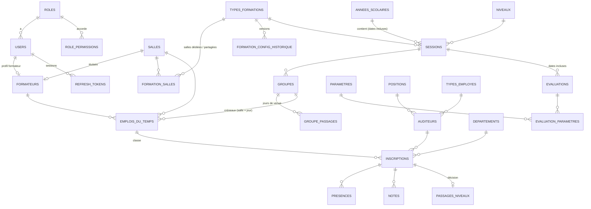

# Audit de la base `academie_langues3` — constat, plan et réalisation

Date : 25/10/2026. Sources analysées : dump `Dump20261025.sql` (31 tables), base réelle, backend
(`Model/`, `Controller/`, `Route/`), frontend (`src/`).

## 0. Réalisation (25/10/2026, validée par l'utilisateur)

Appliqué à la base réelle après essai sur une copie restaurée depuis la sauvegarde :

| Fichier | Contenu |
|---|---|
| `database/migration_2026_10_normalisation.sql` (+ `rollback_…`) | corrections D1–D5 ; identité des formateurs uniquement dans `users` (vue `v_formateurs`) ; téléphone normalisé unique ; 4 colonnes inutilisées supprimées ; `sessions.passages_semaine` calculée ; `jours_autorises` en liste fermée (SET) ; 2 clés étrangères ; 9 index en double supprimés ; 9 déclencheurs de cohérence |
| `database/migration_2026_10_hachage_mots_de_passe.php` | 14 mots de passe hachés (irréversible, sauf restauration) |
| Sauvegarde | `database/backups/backup_avant_normalisation_2026-10-25.sql` |

Colonnes supprimées : `formateurs.nom, prenom, password, telephone, email, actif` (doublons du compte),
`presences.jour_semaine_presence` (jamais lue), `regles_evaluation.passage_automatique` (toujours 0),
`types_formations.config_updated_at` et `refresh_tokens.last_used_at` (doublons d'autres dates).
Colonnes recopiées **conservées** car utiles (filtres, unicité, historique) et désormais garanties par la base :
`inscriptions.id_session/id_annee`, `emplois_du_temps.id_session/id_annee` (déclencheurs),
`presences.id_formateur` (formateur au moment du pointage : valeur historique), horaires des créneaux.

Code adapté : modèles `Formateur` (lecture par la vue), `User` (hachage, téléphone), `Session`,
contrôleurs `User`, `Formateur`, `Profile`, `Session`, `AnneeScolaire`, `Evaluation` (messages 409
explicites avant les déclencheurs), 11 modèles lisant l'identité des formateurs. API inchangée côté frontend.
Corrigé au passage : `UserController` appelait une méthode inexistante (`getPassword`) lors du passage
d'un compte au rôle formateur ; plus aucun mot de passe n'est accepté ni enregistré en clair.

Vérifications après application : `audit_schema.php` → toutes les anomalies à 0 ; PHPUnit 144 tests ;
`npm run test:aide` ; e2e planification (17 contrôles) et e2e de tous les écrans (81 contrôles, 0 erreur
JavaScript) ; installation neuve depuis `DB Gestion Academie.sql` (31 tables, 1 vue, 9 déclencheurs) ;
retour arrière essayé puis migration ré-appliquée sur la copie.

Reste ouvert : R4 (unicité du libellé des critères d'évaluation) — règle métier non confirmée, non appliquée.

Contrôles reproductibles (lecture seule) : `php database/audit_schema.php`.

## 1. État de référence (à revérifier après chaque phase)

| Vérification | Résultat au 25/10/2026 |
|---|---|
| PHPUnit (`phpunit.bat`) — unitaires + intégration sur base jetable | 127 tests, 568 assertions : OK |
| Centre d'aide (`npm run test:aide`) — cohérence code ↔ schéma | OK |
| Navigateur réel (`node tests/e2e-planification.mjs`) | 17 contrôles : OK |
| Lint frontend (`npx eslint src`) | aucune erreur |

Volumétrie : 15 utilisateurs, 11 formateurs, 10 salles, 1 année, 1 session, 5 groupes, 11 créneaux,
0 auditeur / inscription / présence / note. **Le volume est faible : c'est le bon moment pour corriger
la structure**, avant l'arrivée des inscriptions.

## 2. Cartographie des dépendances (tables principales)

| Table | Modèles / contrôleurs backend | Écrans frontend (API) |
|---|---|---|
| `users`, `roles`, `role_permissions`, `refresh_tokens` | User, Role, Authorization, AuthController, UserController, FormateurController | connexion, Utilisateurs, Matrice des droits, Mon profil |
| `formateurs` | Formateur + 10 modèles qui affichent `f.nom` / `f.prenom` (31 références SQL) | Formateurs, Espace formateur, Emplois du temps, Présences, Rapports (13 fichiers lisent `formateur_nom/prenom`) |
| `annees_scolaires`, `sessions`, `groupes`, `groupe_passages` | AnneeScolaire, Session, Groupe, Planification, EmploiDuTemps, Dashboard, Rapport, Resultat | Paramètres › Années / Sessions / Groupes, Emplois du temps, tableau de bord |
| `types_formations`, `formation_salles`, `formation_config_historique` | TypeFormation, FormationConfig, Planification | Paramètres › Types de formation, Emplois du temps › Formations & salles |
| `salles` | Salle, Formateur, EmploiDuTemps, Planification | Salles, Emplois du temps |
| `emplois_du_temps`, `planification_generations` | EmploiDuTemps, Planification, Inscription, Presence, Dashboard, Rapport, TrainerPortal | Emplois du temps (toutes vues), Inscriptions, Présences |
| `auditeurs`, `positions`, `types_employes`, `departements` | Auditeur, Inscription, Presence, Rapport, Resultat | Auditeurs & inscriptions, Paramètres |
| `inscriptions` | Inscription + 14 modèles ; `i.id_session` / `i.id_annee` utilisés dans 24 requêtes de filtrage | Inscriptions, Présences, Évaluations, Rapports |
| `presences` | Presence, TrainerPortal, Dashboard, Rapport, Resultat | Présences, Espace formateur |
| `evaluations`, `evaluation_parametres`, `parametres`, `notes`, `regles_evaluation`, `baremes_appreciation`, `passages_niveaux` | Evaluation, Note, ParametreEvaluation, Resultat, PassageNiveau, ReglesEvaluation | Évaluations & notes, Paramètres |
| `journal_operations` | Journal (toutes les écritures via `Route/api.php`), Rapport | Utilisateurs › Journal |

Toutes les requêtes sont préparées (PDO, `ATTR_EMULATE_PREPARES = false`) ; aucune requête n'assemble
une saisie utilisateur dans le SQL. Les seules interpolations portent sur des noms de colonnes internes.

## 3. Problèmes confirmés

Gravité : **C** critique, **M** majeur, **m** mineur. « Preuve » = résultat de `audit_schema.php` ou du code.

### 3.1 Sécurité

| # | Gr. | Constat | Preuve |
|---|---|---|---|
| S1 | C | Mots de passe stockés **en clair** : 14 comptes sur 15. `User::create()` enregistre le mot de passe « tel que fourni » ; `UserController::update` et `FormateurController` aussi. Seul le changement depuis « Mon profil » hache. | `Model/User.php` l.17 ; audit : 14 |
| S2 | C | `formateurs.password` : **copie en clair** du mot de passe du compte, jamais vérifiée nulle part (la connexion lit `users`). Donnée sensible dupliquée sans usage. | audit : 11 ; aucun `password_verify` sur `formateurs` |
| S3 | M | La connexion accepte l'e-mail **ou le téléphone**, mais `users.telephone` n'est pas unique : deux comptes de même numéro rendraient la connexion ambiguë (`LIMIT 1`). Aucun doublon aujourd'hui. | `Model/User.php` l.70 |
| S4 | m | Formats de téléphone hétérogènes (`771234567` / `627 15 55 97`) : « 627155597 » ne permet pas de se connecter au compte « 627 15 55 97 ». | dump |

Points vérifiés **sans anomalie** : aucune API ne renvoie de mot de passe (champ retiré dans les
contrôleurs) ; le journal masque `password`, `token`, `refresh_token`, `access_token` ; contrôle d'accès
par rôle sur chaque ressource ; JWT avec révocation.

### 3.2 Données incohérentes (impact fonctionnel réel)

| # | Gr. | Constat | Conséquence |
|---|---|---|---|
| D1 | **C** | La session **SN2** (06/10/2026 → 31/03/2027) dépasse son année scolaire (01/01/2026 → 31/12/2026). Deux évaluations (31/01 et 31/03/2027) sont aussi hors année. | À partir du 01/01/2027 : **plus aucune séance au calendrier, pointage des présences refusé** (« la date n'est pas dans l'année scolaire »). Rien n'empêche cette saisie. |
| D2 | m | Groupe **G4** a le libellé « Groupe 3 », identique à G3. | Confusion dans les listes. |
| D3 | m | Espaces parasites : formateur « GOUAVOGUI␠ », utilisateur « ␠Balla ». | Tri et recherche faussés. |
| D4 | m | Aucune année scolaire active (`statut = 0` partout). | L'écran choisit l'année par les dates ; l'indicateur « active » est vide. |
| D5 | m | Rôle n° 4 nommé « … Administrative **er** Comptable ». | Faute visible. |

### 3.3 Conception et normalisation

Les tables respectent la 1NF (valeurs atomiques), à deux exceptions **introduites par la planification** :
`types_formations.jours_autorises` (liste « 1,2,3,4,5 ») et les colonnes JSON `creneaux` / `config_formation`.
Le JSON `config_formation` est un **instantané historique voulu** (une session garde la configuration de sa
création) : ce n'est pas une redondance à supprimer.

Dépendances transitives (3NF) — colonnes recopiées d'une autre table :

| # | Colonne recopiée | Source | Cohérence actuelle | Utilité |
|---|---|---|---|---|
| N1 | `formateurs.nom, prenom, telephone, email, actif, password` | `users` (via `user_id`) | 0 écart, synchronisé par le code à 2 endroits | aucune hors affichage ; 31 requêtes lisent `f.nom` |
| N2 | `inscriptions.id_annee`, `id_session` | `emplois_du_temps → groupes → sessions` | 0 écart | filtres et index de 24 requêtes |
| N3 | `emplois_du_temps.id_annee`, `id_session` | `groupes → sessions` | 0 écart | filtres, contraintes d'unicité par session |
| N4 | `emplois_du_temps.heure_debut/fin`, `groupes.jour_semaine/heure_*` | `groupe_passages` | 0 écart | conflits horaires indexés ; compatibilité |
| N5 | `presences.id_formateur` | `emplois_du_temps.id_formateur` | 0 écart (0 présence) | rapports par formateur |
| N6 | `sessions.passages_semaine` | `sessions.config_formation` | 0 écart | lecture rapide |

**Avis** : N2 à N6 sont des dénormalisations **utiles** (performances, unicité, historique) ; les supprimer
obligerait à réécrire une cinquantaine de requêtes pour un gain nul à ce volume. Le vrai risque est la
divergence : il se traite en confiant leur remplissage **à la base** (déclencheurs), pas au code seul.
N1 est la seule redondance sans justification : l'identité d'une personne existe deux fois et un mot de
passe y est copié.

### 3.4 Intégrité référentielle et index

| # | Gr. | Constat |
|---|---|---|
| R1 | m | `refresh_tokens.remplace_par` et `emplois_du_temps.id_generation` référencent une autre table sans clé étrangère. |
| R2 | M | Aucune règle en base ne garantit qu'une session reste dans son année, ni qu'une évaluation reste dans sa session (origine de D1). |
| R3 | m | 9 index simples entièrement couverts par un index composite qui commence par la même colonne (ex. `idx_groupes_session` ⊂ `uk_groupes_session_code`). Ils ralentissent les écritures sans servir les lectures. Liste exacte : `audit_schema.php`. |
| R4 | — | `parametres.libelle` sans unicité : deux critères « Lecture » sont possibles. **Règle métier à confirmer** avant d'ajouter une contrainte. |

## 4. Schéma cible

Aucune table ni colonne n'est supprimée dans les phases 1 à 3. La phase 4 (formateurs) est la seule
restructuration, progressive et réversible.

MLD — changements prévus par rapport au schéma actuel :

| Table | Changement | Phase |
|---|---|---|
| `users` | `password` toujours haché ; `telephone_normalise` (colonne générée sans espaces) + index unique | 1 |
| `formateurs` | `password` remplacé par une valeur neutre (colonne conservée, plus jamais lue) | 1 |
| `inscriptions`, `emplois_du_temps`, `presences` | déclencheurs qui remplissent les colonnes dérivées (N2, N3, N5) et refusent une incohérence | 2 |
| `sessions`, `evaluations` | déclencheurs : dates incluses dans l'année / la session | 2 |
| `refresh_tokens`, `emplois_du_temps` | clés étrangères `remplace_par`, `id_generation` (ON DELETE SET NULL) | 2 |
| 9 index | suppression des index couverts | 3 |
| `formateurs` | identité lue depuis `users` (vue `v_formateurs`), colonnes dupliquées conservées puis retirées | 4 |

## 5. Plan de migration

Chaque phase : sauvegarde → migration testée sur `academie_langues3_test` → tests (§1) →
application → `audit_schema.php` → validation. Chaque fichier `migration_*.sql` aura son
`rollback_*.sql`. Les migrations sont tracées dans `schema_migrations` (`database/apply_migration.php`).

| Phase | Contenu | Risque pour l'application | Réversible |
|---|---|---|---|
| **1. Sécurité** | Hachage de tous les mots de passe (script PHP, `password_hash`) ; hachage systématique à la création / modification (User, UserController, FormateurController) ; fin de la copie dans `formateurs.password` ; unicité du téléphone normalisé ; connexion par téléphone sans tenir compte des espaces | Faible : la connexion vérifie déjà les hachages. **Les mots de passe en clair deviennent illisibles en base** (ils restent dans la sauvegarde) | Oui, par restauration de la sauvegarde |
| **2. Intégrité** | Correction de D1–D5 (après vos décisions) ; déclencheurs de cohérence ; contrôles de dates en base et dans les contrôleurs Session / Évaluation ; clés étrangères R1 | Faible : les écritures valides sont inchangées ; les saisies incohérentes sont refusées avec un message clair | Oui (`rollback` supprime déclencheurs et clés) |
| **3. Performance** | Suppression des 9 index couverts (après vérification que chaque clé étrangère garde un index) | Très faible | Oui (recréation) |
| **4. Formateurs** | Vue `v_formateurs` (identité depuis `users`) ; adaptation des 31 requêtes ; frontend inchangé (mêmes champs `formateur_nom` / `formateur_prenom` renvoyés par l'API) ; retrait des colonnes dupliquées seulement après une période d'observation | Moyen : nombreux fichiers touchés, couverts par les tests | Oui tant que les colonnes ne sont pas retirées |

Retour arrière général : `database/backups/` contient la sauvegarde complète d'avant la planification ;
une nouvelle sauvegarde est prise avant chaque phase
(`mysqldump --single-transaction --routines --triggers academie_langues3`). Restauration :
`mysql academie_langues3 < sauvegarde.sql`, puis retour au commit Git correspondant.

## 6. Décisions à prendre avant d'appliquer

1. **D1 — SN2 hors année** : prolonger l'année « 2026-2027 » jusqu'au 31/03/2027 au moins (son libellé
   l'annonce), ou raccourcir la session ? Sans correction, le pointage sera bloqué dès le 01/01/2027.
2. **S1/S2 — hachage** : confirmer qu'aucune procédure ne repose sur la lecture des mots de passe en base
   (ils deviendront irrécupérables ; une réinitialisation restera possible par l'administrateur).
3. **D2** : renommer G4 en « Groupe 4 » ?
4. **R4** : deux critères d'évaluation peuvent-ils porter le même libellé ?
5. **Phase 4** : la lancer maintenant ou après la mise en service ?
